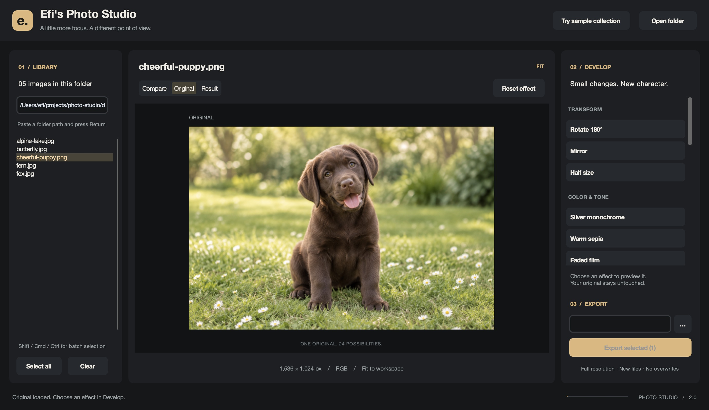
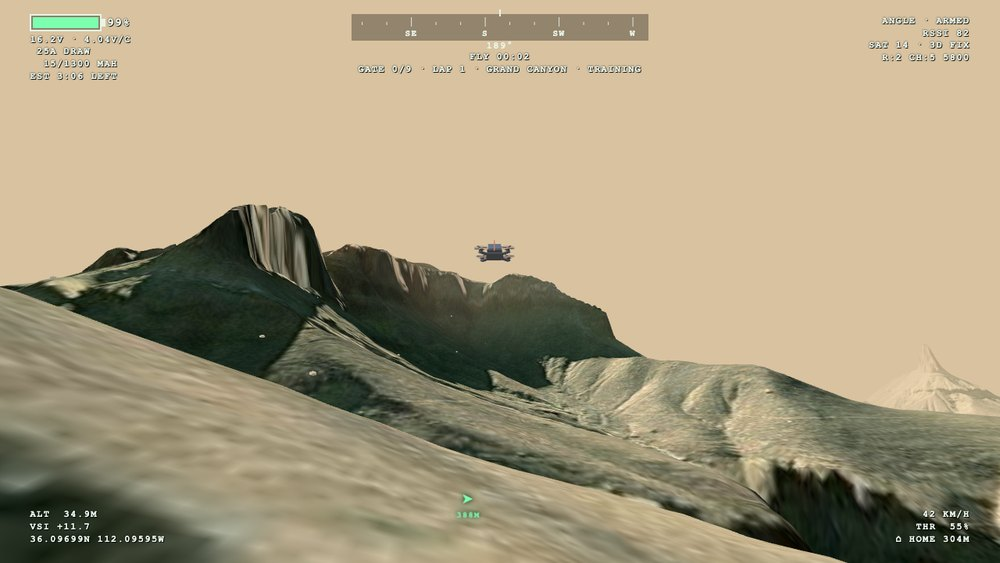
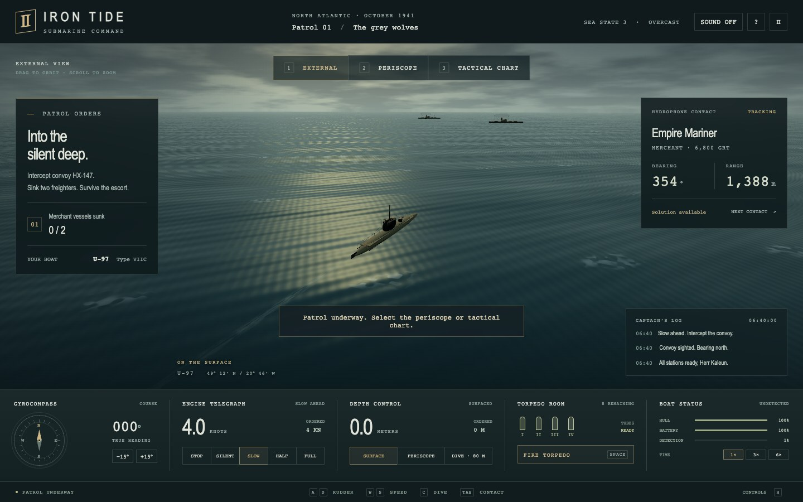

  

  <a href="https://github.com/eforus-overseer">LinkedIn</a> &nbsp; / &nbsp;
  <a href="https://x.com/eforus_overseer">X</a> &nbsp; / &nbsp;
  <a href="https://github.com/eforus-overseer?tab=repositories">Explore the repositories</a>

### Hey, I'm Efi ! 🖖

I'm an AI researcher and data engineer. I like turning interesting ideas into working experiments: training agents, investigating how language models fail, building security tools, and making things you can actually interact with.

I've been working with machine learning since before everything became “cool AI stuff.” The curiosity stuck. Give me a new method or tool and I'll probably build a proof of concept with it.

**My recurring interests:** language models · reinforcement learning · cybersecurity · data visualization

### A few things I've built

<table>
  <tr>
    <td width="42%">
      
    </td>
    <td>
      <strong><a href="https://github.com/eforus-overseer/photo-studio">Photo Studio</a></strong> 
      A photography playground with 24 desktop effects, foreground segmentation, and an interactive browser demo.  
      <a href="https://eforus-overseer.github.io/photo-studio/">Try the demo ↗</a> · <a href="https://github.com/eforus-overseer/photo-studio">Source</a> 
      Python · OpenCV · CustomTkinter · Canvas
    </td>
  </tr>
  <tr>
    <td width="42%">
      
    </td>
    <td>
      <strong><a href="https://github.com/eforus-overseer/propwash">PROP//WASH</a></strong> 
      FPV flight over real satellite terrain. Quaternion flight physics, race gates, and a whole lot of altitude.  
      <a href="https://github.com/eforus-overseer/propwash">Explore the simulator ↗</a> 
      JavaScript · Three.js · Terrain data
    </td>
  </tr>
  <tr>
    <td width="42%">
      
    </td>
    <td>
      <strong><a href="https://github.com/eforus-overseer/iron-tide-submarine">Iron Tide</a></strong> 
      A Silent Hunter–inspired submarine game. Hunt convoys, line up torpedoes, and evade destroyers in the browser.  
      <a href="https://github.com/eforus-overseer/iron-tide-submarine">Dive into the project ↗</a> 
      JavaScript · Three.js · Naval simulation
    </td>
  </tr>
</table>

### Academic work

Reichman University. Security and AI safety, then the retrieval courses beside them.

#### LLM security

Training text, and generated text. What a fine-tune can plant, and what you can catch without keeping the whole stream.

<table>
  <tr>
    <td width="50%" valign="top">
      
       
      <strong><a href="https://github.com/eforus-overseer/Literary-LLM-Knowledge-Data-Poisoning">Unstable Canon</a></strong>
      &nbsp; 2025 · with Adi Zur
       
      Fine-tunes Llama on novels whose names and places were swapped, then checks whether the model learned the planted fact.
       
      In the four saved runs, 87–89 of 100 answers changed, and the planted phrase appeared in 0–3 of them.
       
      data poisoning · LoRA · Llama 3.1
    </td>
    <td width="50%" valign="top">
      
       
      <strong><a href="https://github.com/eforus-overseer/llm-hallucination-sketches">Hallucination Sketches</a></strong>
      &nbsp; 2026 · with Guy Hasson
       
      Treats LLM output as a token stream and flags distributional drift with five classic sketches.
       
      F1 = 0.77 using 256 bytes of memory.
       
      sketches · hallucination · streaming
    </td>
  </tr>
</table>

#### Attack and fraud detection

Login logs, network flows, and mail that should stay inside the company.

<table>
  <tr>
    <td width="50%" valign="top">
      
       
      <strong><a href="https://github.com/eforus-overseer/streaming-attack-detection">Streaming Attack Detection</a></strong>
      &nbsp; 2026
       
      Classifies UNSW-NB15 flows from sketch features, one 30-second window at a time.
       
      F1 = 0.90 with 146 KB of sketch memory per window. The exact baseline reached F1 = 0.92.
       
      sketches · UNSW-NB15 · network detection
    </td>
    <td width="50%" valign="top">
      
       
      <strong><a href="https://github.com/eforus-overseer/Credential-Stuffing-Detection-Framework">Credential Stuffing</a></strong>
      &nbsp; 2024
       
      Reads anonymized login logs for the rhythm of automated credential stuffing.
       
      The measured signal the write-up highlights is velocity above 0.02 attempts per second from a single IP.
       
      credential stuffing · login logs · anomaly detection
    </td>
  </tr>
  <tr>
    <td width="50%" valign="middle">
      
    </td>
    <td width="50%" valign="top">
      <strong><a href="https://github.com/eforus-overseer/Enron-DLP-Policy-Enforcement">Enron DLP</a></strong>
      &nbsp; 2024
       
      Flags Enron mail that breaks data-loss rules: a keyword and topic layer, then XGBoost on what the rules allowed.
       
      Grid search brought the XGBoost F1 to 0.5, on 138,512 allowed messages and 16,709 blocked.
       
      DLP · XGBoost · Enron corpus
    </td>
  </tr>
</table>

#### Harmful content

Memes, where the harm sits in the picture and the caption together.

<table>
  <tr>
    <td width="50%" valign="top">
      
       
      <strong><a href="https://github.com/eforus-overseer/Harmfull-Content-Detection-Classification-BLIP2-OCR-CLIP">BLIP-2, OCR, and CLIP</a></strong>
      &nbsp; 2025
       
      Compares an OCR plus BLIP-2 reading of a meme with CLIP looking at the image directly.
       
      OCR + BLIP-2 reached F1 0.73 at accuracy 0.58. CLIP was about 3× faster, at F1 0.55 and 0.57.
       
      BLIP-2 · OCR · CLIP
    </td>
    <td width="50%" valign="top">
      
       
      <strong><a href="https://github.com/eforus-overseer/Multimodal-Harmful-Content-Detection-Social-Media-Memes-">Multimodal Meme Detection</a></strong>
      &nbsp; 2025 · with Stav Cohen
       
      Joins a meme-image CNN and a text classifier through several fusion rules, on the Facebook harmeme set.
       
      Aggressive fusion reached F1 0.514, just above the image model at 0.510.
       
      memes · fusion · CNN
    </td>
  </tr>
</table>

#### Retrieval

Find the passage, then answer from it.

<table>
  <tr>
    <td width="50%" valign="top">
      
       
      <strong><a href="https://github.com/eforus-overseer/RAG-QA-Wikipedia">Wikipedia RAG</a></strong>
      &nbsp; 2026 · with Raz Cohen
       
      Answers open-domain questions over Wikipedia with BM25, query likelihood, a cross-encoder rerank, and a short LLM reply that retries when the first answer looks empty.
       
      RAG · BM25 · Wikipedia
    </td>
    <td width="50%" valign="top">
      
       
      <strong><a href="https://github.com/eforus-overseer/Text-Retrieval-ROBUST04-Ranking">ROBUST04 Ranking</a></strong>
      &nbsp; 2026 · with Raz Cohen
       
      Ranks 528,030 news documents with BM25, RM3 expansion, and a cross-encoder on top of query likelihood.
       
      BM25+RM3 reached MAP 0.2713 on the training queries. The cross-encoder beat LambdaMART on the held-out set.
       
      ranking · BM25 · cross-encoder
    </td>
  </tr>
</table>

### Open security tooling

Smaller, and open. Tools and labs, rather than course reports.

<table>
  <tr>
    <td width="50%" valign="top">
      <strong><a href="https://github.com/eforus-overseer/zeroth-index">Zeroth Index</a></strong>
       
      A field guide to prompt-injection patterns: 27 intents, 70 techniques, 63 evasions, and 12 inputs.
       
      <a href="https://eforus-overseer.github.io/zeroth-index/">Open the index</a> · prompt injection · taxonomy
    </td>
    <td width="50%" valign="top">
      <strong><a href="https://github.com/eforus-overseer/caterpillar">Caterpillar</a></strong>
       
      Scans AI agent skill files for malicious patterns before install. A fork of <a href="https://github.com/alice-dot-io/caterpillar">alice-dot-io/caterpillar</a>.
       
      agent skills · scanner
    </td>
  </tr>
  <tr>
    <td width="50%" valign="top">
      <strong><a href="https://github.com/eforus-overseer/open-model-backdoor-lab">Open Model Backdoor Lab</a></strong>
       
      An offline harness for behavioral backdoor checks, with a harmless toy benchmark and HTML reports.
       
      backdoors · open-weight models · reproducibility
    </td>
    <td width="50%" valign="top">
      <strong><a href="https://github.com/eforus-overseer/agent-injection-arena">Agent Injection Arena</a></strong>
       
      Offline fixtures for indirect prompt injection and the tool actions an agent should refuse.
       
      agents · prompt injection · benchmark seed
    </td>
  </tr>
  <tr>
    <td width="50%" valign="top">
      <strong><a href="https://github.com/eforus-overseer/rag-poisoning-lab">RAG Poisoning Lab</a></strong>
       
      A local lab for a synthetic corpus edit, and how it moves retrieval, citations, and answers.
       
      RAG · data poisoning · provenance
    </td>
    <td width="50%" valign="top">
      <strong><a href="https://github.com/eforus-overseer/llm-safety-projects">LLM Safety Projects</a></strong>
       
      An index of twelve open safety repos. Eleven are scoped seeds; the backdoor lab above is the one with a runnable demo.
       
      llm safety · collaboration · project seeds
    </td>
  </tr>
</table>

### Also on the bench

- **[LunarLander: DQN vs. PPO](https://github.com/eforus-overseer/LunarLander-DQN-vs-PPO)** · Implementing and comparing reinforcement learning agents in PyTorch and Gymnasium.
- **[Octo Browser MCP](https://github.com/eforus-overseer/octobrowser-mcp)** · Browser profile management and automation through MCP.
- **[Visual Vocabulary](https://github.com/eforus-overseer/visual-vocabulary-skill)** · Choosing the right chart, with a 62-chart Matplotlib gallery.

### Tools I reach for

**Models & data** &nbsp; Python · PyTorch · scikit-learn · pandas · NumPy · OpenCV 
**Experiments & interfaces** &nbsp; Gymnasium · Matplotlib · Plotly · JavaScript · TypeScript · Three.js 
**Automation & infrastructure** &nbsp; Playwright · Docker · Git · AWS

<strong>A little history: from 2018 to now</strong>

My original [Photo Editor GUI](https://github.com/eforus-overseer/Photo-Editor-GUI) was written entirely by hand in 2018, before today's AI coding assistants. It's preserved as a legacy project.

[Photo Studio](https://github.com/eforus-overseer/photo-studio) revisits that idea with an AI-assisted development workflow, a redesigned interface, more effects, and segmentation. Same curiosity, new tools. Also, a much cuter Labrador.

---

Research it. Build it. See what happens.

---

<!-- demo-lab:start -->
## Explore this project

[Project page & walkthrough](https://eforus-overseer.github.io/demo-lab/projects/eforus-overseer/) — Read an archive walkthrough describing this repository's current state.

[Browse all 40 project pages in eforus-overseer's Demo Lab](https://eforus-overseer.github.io/demo-lab/).
<!-- demo-lab:end -->

<!-- codex-pixel-art -->

